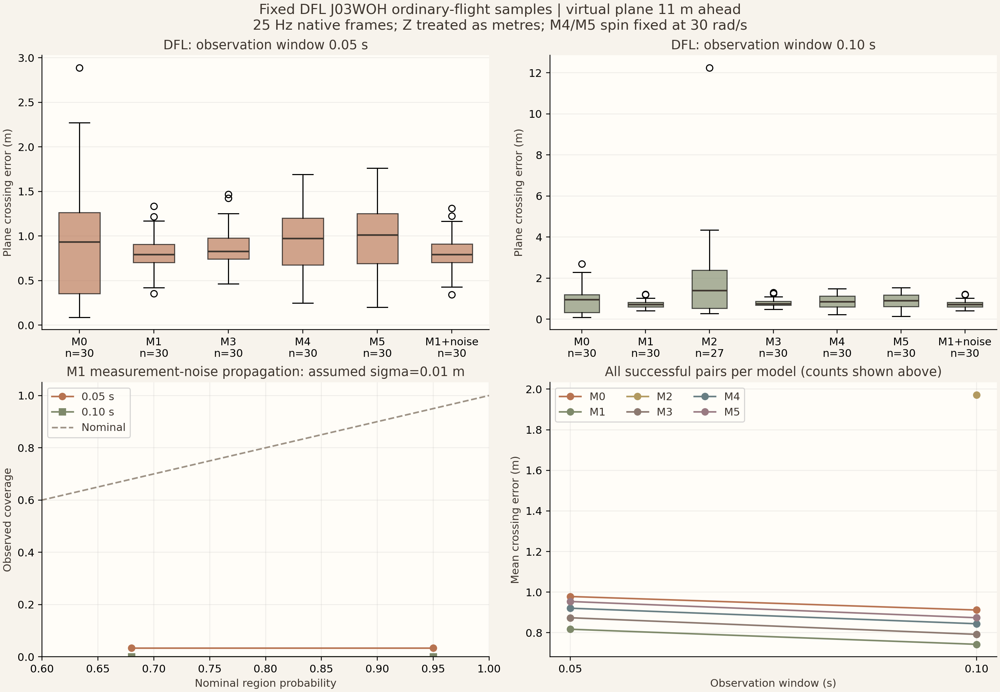

# 电脑 C：真实数据与独立验证阶段报告

日期：2026-11-07。

根据早期位置预测足球落点，需要先把观测和答案分开。已有程序能够读取一段比赛轨迹并运行模型；本次把数据获取、质量检查、样本筛选、观测截断和评价整理成一条可复现流程。预测器只接收当前时刻之前的实测帧，各模型共用同一份固定清单。

本次完成了 DFL 真实数据的 30 段比较，以及独立的 100 条合成轨迹检查。单元与接口测试共 **52 项通过**。真实实验生成 420 条模型记录，运行错误为 0；完整重复运行后，除耗时外的逐例结果和汇总结果完全一致。

## 数据核查和样本

DFL 的[官方资料](https://github.com/spoho-datascience/idsse-data)和 [Figshare 元数据](https://api.figshare.com/v2/articles/28196177)公开了七场比赛及 CC BY 4.0 许可。本次获取 J03WOH 位置 XML，348,945,715 字节；官方 MD5 为 `3efff25a86a61768e7d253b4bba137a3`，下载文件核验一致。实际文件来自固定版本的公开镜像，获取记录保存在样本清单中。使用时注明 Deutsche Fußball Liga（DFL），并引用 [Bassek 等人的论文](https://doi.org/10.1038/s41597-025-04505-y)。

解析出 137,214 条球位置记录：没有缺失、重复帧号、重复时间戳或非递增时间；两个半场内部的 137,212 个相邻时间差均为 0.04 秒。全场有 101 次相邻速度超过 60 m/s 的跳变，已在质量报告中保留计数。

程序按预先写好的规则寻找连续 21 帧的空中片段，检查比赛状态、球高、速度和速度突变。入选片段之间至少间隔 50 个源行，即规则采样下的 2 秒。按原始顺序取前 30 段，从上半场第 10062 帧开始，最后一段始于第 32779 帧。检查了 21,359 个候选起点，另有 1,470 个起点按间隔规则跳过；所有起点的处理原因均已保存。

| 起点处理结果 | 数量 |
|---|---:|
| 入选 | 30 |
| 比赛未进行或跨半场 | 11,725 |
| 球高不在预设范围 | 8,501 |
| 速度不在预设范围 | 151 |
| 速度突然改变 | 422 |
| 首次水平位移不足 | 137 |
| 后续没有合格的平面穿越 | 393 |
| 为保持间隔而跳过 | 1,470 |

坐标方向仅由前两帧确定，预测平面是前方 11 米的虚拟平面。0.05 秒输入为 0、0.04 秒两帧，0.10 秒输入为 0、0.04、0.08 秒三帧。后续帧只用于筛选和求取真实穿越位置。当前 Z 取米且按球心高度使用，换算假设显式写入清单；源论文未明确给出 Z 的单位，kloppy 的 Sportec 解析器直接读取该字段。

[ball3d 的说明](https://github.com/lukaszgrad/ball3d/blob/main/DATA.md)明确位置使用分米，帧号除以片段实际 fps 得到时间；已完成适配器及单位、缺帧和重复帧测试。本次下载目录跳转 Google 登录，未取得该版本的轨迹文件，文件大小仍待核实。[SoccerNet-GAR](https://huggingface.co/datasets/OpenSportsLab/SoccerNet-GAR)要求申请并签署 NDA，本次仅核查资料。数据来源记录集中在 `data/sources/data_validation.json`。

## M0–M5 的实际比较

各模型都拟合观测窗口内的初速度，参数配置在两次预测之间保持一致。M4、M5 的竖直轴自旋固定为 30 rad/s；M5 调用仓库已有的气动关系。M2 用三个位置拟合匀加速度，所以两帧窗口记录为观测不足。

下表每格为“平均／中位／90%分位误差”，单位米。0.05 秒使用五个可运行物理模型共同成功穿越的 30 条；0.10 秒使用全部六个模型共同成功穿越的 27 条。

| 模型 | 0.05 秒窗口，30 条 | 0.10 秒窗口，27 条 |
|---|---:|---:|
| M0 | 0.978／0.935／1.910 | 0.812／0.934／1.289 |
| M1 | 0.817／0.795／1.159 | 0.726／0.705／0.960 |
| M2 | 两帧不足 | 1.971／1.397／3.319 |
| M3 | 0.874／0.829／1.229 | 0.789／0.751／1.073 |
| M4 | 0.921／0.972／1.384 | 0.831／0.849／1.291 |
| M5 | 0.954／1.014／1.405 | 0.859／0.898／1.349 |

M0、M1、M3、M4、M5 在两个窗口均有 30 次穿越。M2 在三帧窗口有 27 次穿越、1 次先触地、2 次在统一的 2 秒范围内未到平面；两帧窗口的 30 条观测不足记录全部保留。每个模型各自的全部有效样本统计也单独保存，例如 M1 的三帧窗口在全部 30 条上的平均误差为 0.743 米。

这份固定清单上，重力模型 M1 的误差小于其余物理配置；再增加阻力和固定自旋没有改善结果。后续可以用其他比赛、明确的触球事件和独立的参数估计来检查这一现象。

## 预测区域检查

加入一个附加的 M1 基线：假设每轴位置误差为独立高斯、标准差 0.01 米；仅扰动已观测位置，重复拟合 256 次。穿越样本形成落点云，用于计算区域与能量评分。总随机种子为 20261107，单个样本和模型各有独立随机数流。

| 数据与窗口 | 案例数 | 平均落点误差 m | 68% 区域覆盖 | 95% 区域覆盖 | 平均能量评分 m |
|---|---:|---:|---:|---:|---:|
| DFL，0.05 秒 | 30 | 0.817 | 1/30 | 1/30 | 0.693 |
| DFL，0.10 秒 | 30 | 0.742 | 0/30 | 0/30 | 0.674 |
| 合成轨迹，0.05 秒 | 100 | 0.152 | 67/100 | 92/100 | 0.109 |
| 合成轨迹，0.10 秒 | 100 | 0.077 | 64/100 | 95/100 | 0.055 |

合成实验用已知重力轨迹叠加同样的 0.01 米观测噪声，检查截断和误差传播流程。真实数据上的区域明显过窄：仅靠这个位置误差假设无法描述实际预测偏差。下一步应同时研究测量误差水平和模型偏差，再在独立样本上检查覆盖率。

穿越事件另用 Brier 评分，计算全部提供概率的案例；M2 三帧窗口为 0.100，其余可用模型为 0。本次真实清单筛选的是有真实穿越的片段；汇总中的真实未穿越数为 0，接口测试另包含未穿越案例。区域覆盖和能量评分仅针对相应的穿越条件分布，文件中同时列出各自分母。

本机确定性物理模型平均调用耗时约 0.022–0.107 秒；M2 和 M1 解析误差传播基线低于 0.001 秒。计时包括拟合与预测，评分、读取和绘图另行执行。



## 交接与后续

分支为 `codex/data-validation`。接口和完整命令见 [C_数据接口与复现.md](C_数据接口与复现.md)。最短复现方式：

```powershell
$env:PYTHONPATH='src'
python -m pytest -q --basetemp=.pytest_tmp
python scripts/benchmark_data_validation.py
python scripts/plot_data_validation.py
python scripts/validate_data_protocol.py
```

交付文件包括固定样本与来源清单、逐起点筛选记录、420 条真实模型预测、真实与合成实验汇总、PNG/SVG 图、独立评价接口和测试。大型原始 XML 留在本地；小型已处理轨迹随分支提交，可直接复现比较。`verification.json` 记录 52 项测试和两次运行一致性检查。

下一阶段需要确认 DFL 高度单位及参考点、结合比赛事件排除中途触球并按事件分组、加入其他比赛；ball3d 文件取得后可直接使用已验证的适配器。M3–M5 的概率推断由整合端接入统一预测接口，本次区域检查先采用明确的 M1 基线。
