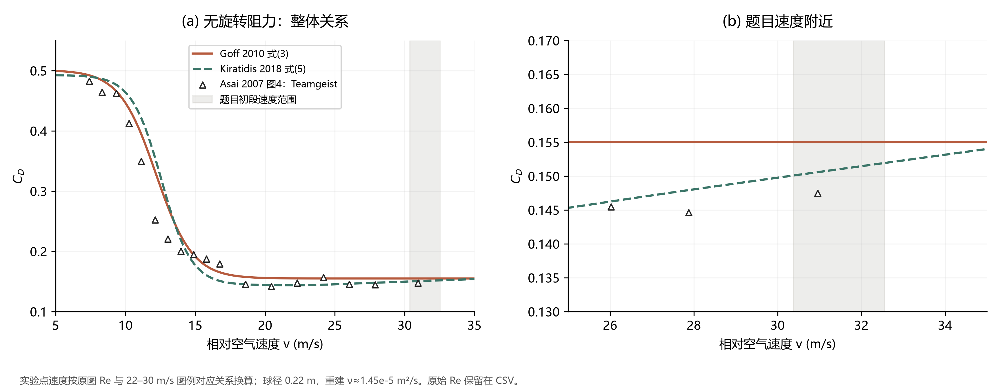
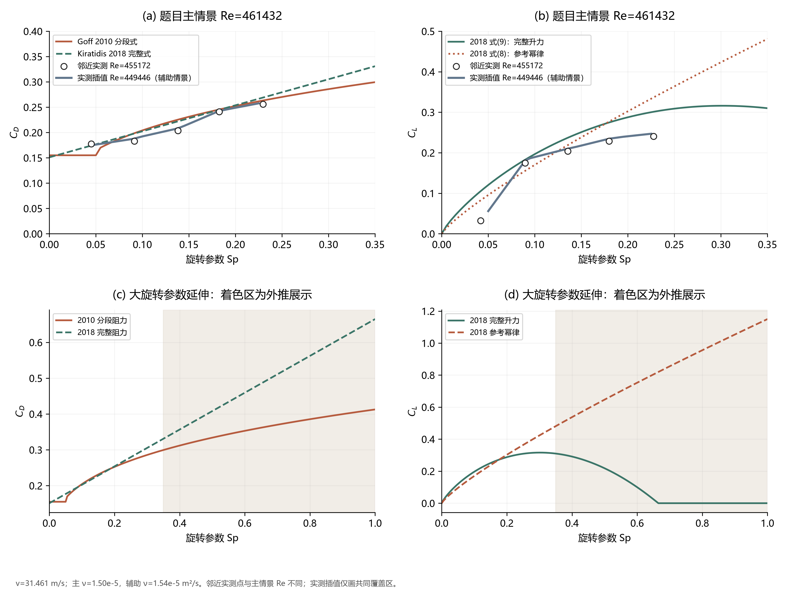
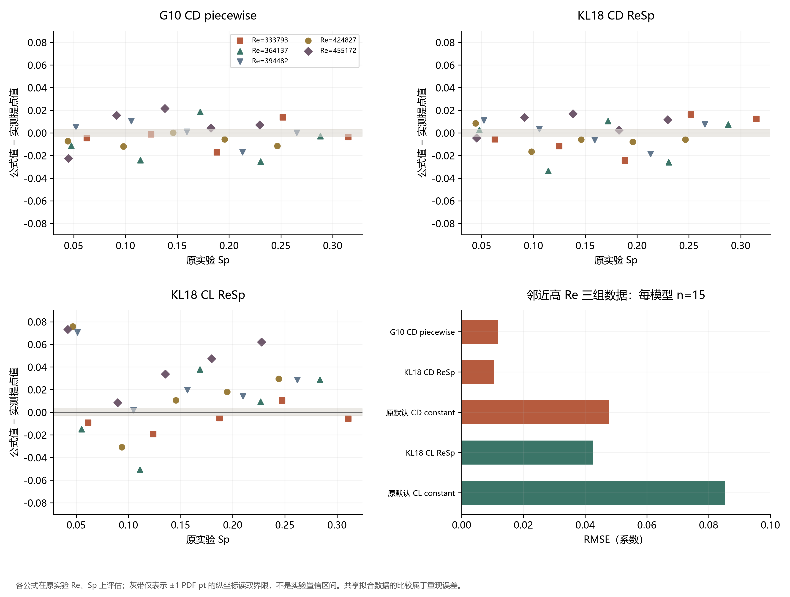
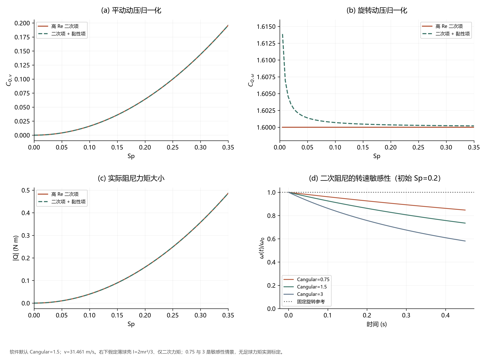

# Problem B：足球气动参数文献核查与建模交接

核查日期：2026-11-07。主对照球型：Teamgeist。长度、时间、质量均采用 SI 单位。

这份说明回答两个问题：指定论文实际给了哪些经验关系，以及这些关系在本题约 31 m/s 的速度下与 2007 年风洞数据相符到什么程度。计算结果见[主对照 CSV](../data/processed/aerodynamic_parameters/参数对照.csv)，原始图形提点见[实测提点表](../data/sources/aerodynamic_parameters/asai2007_digitized.csv)。全部图表由配套 Python 脚本生成。

**建议先把固定 CD 改为随速度和旋转变化的关系；CL 优先使用实测范围内的插值，并用 2018 年完整模型作对照。CQ 应先明确归一化再接入力矩方程：MuJoCo 的高雷诺数球形模型给出平动动压归一化的 CQ 正比于 Sp²，旋转动压归一化的 CQ 为常数。Sp⁻² 是两种归一化之间的换算因子。**

## 1. 物理定义：先固定力与系数的口径

### 1.1 速度、旋转与雷诺数

令球心速度为 \(\mathbf v_b\)，风速为 \(\mathbf w\)，相对空气速度为

\[
\mathbf u=\mathbf v_b-\mathbf w,\qquad v=\|\mathbf u\|,\qquad
r=0.11\ {
m m},\quad D=2r,\quad A=\pi r^2.
\]

角速度向量为 \(\boldsymbol\omega\)，大小为 \(\omega\)。本文统一使用

\[
\nu=\mu/\rho,\qquad Re=\frac{vD}{\nu}=\frac{\rho vD}{\mu},
\qquad Sp=\frac{r\omega}{v}.
\]

其中 \(\mu\) 是动力黏度，单位 Pa·s；\(\nu\) 是运动黏度，单位 m²/s。\(Re\)、\(Sp\) 均无量纲，rad 按无量纲处理。若转速为 \(n\) rev/s 或 \(N\) rpm，则

\[
\omega=2\pi n=2\pi N/60,\qquad
n=\frac{Sp\,v}{2\pi r},\qquad N=60n.
\]

研究旋转阻力时另定义 \(Re_\omega=\omega r^2/\nu=Sp\,Re/2\)。这是本文为检查旋转惯性/黏性尺度引入的定义，特征长度取半径；它与平动雷诺数区分使用。

**固定球径与空气状态后，v 与 Re 一一对应，不是两个独立自变量。** 指定论文主要给出 \(C_D(v)\)、\(C_D(v,Sp)\)、\(C_D(Re,Sp)\)、\(C_L(Sp)\) 或 \(C_L(Re,Sp)\)。只有指定转速条件，才能把升力关系改写成单变量 \(C_L(v)\)。本次同时保留原始形式和换算形式，没有另造独立的 \(C(v,Re)\) 拟合。

### 1.2 阻力、升力与旋转阻尼

以动压 \(q=\rho v^2/2\) 定义

\[
\mathbf F_D=-qA C_D\frac{\mathbf u}{v},\qquad
\mathbf F_L=qA C_L\frac{\boldsymbol\omega\times\mathbf u}{\|\boldsymbol\omega\times\mathbf u\|},
\qquad m\dot{\mathbf v}_b=m\mathbf g+\mathbf F_D+\mathbf F_L.
\]

上述升力幅值对应文献的**横向旋转**条件，即旋转轴垂直于来流。2007 年图 9 的原符号是侧向力系数 \(C_S\)，其方向在实验中承担 Magnus 横向力；2010、2018 年把这组数据作为升力系数使用。本文在对照时将它统一列为 CL，CSV 同时保留 `original_symbol=Cs`。

现有代码对斜旋转轴采用 \(F_L=qAC_L\sin\theta\)，其中 \(\sin\theta=\|\boldsymbol\omega\times\mathbf u\|/(\omega v)\)。这是项目向三维推广的闭合假设；五篇指定资料的横向旋转数据本身没有标定这个角度函数。零转速或旋转轴平行来流时，Magnus 力置零；\(v=0\) 时直接计算零气动力，避免先计算 Sp。

旋转阻尼力矩统一写成

\[
\mathbf Q=-qAr C_{Q,v}\widehat{\boldsymbol\omega},\qquad
I_b\dot{\boldsymbol\omega}=\mathbf Q.
\]

球形、各向同性转动惯量时使用上式。薄球壳近似 \(I_b=2mr^2/3\)；实心球为 \(2mr^2/5\)。足球交接建议采用薄球壳作为明确近似，并保留实测惯量入口。若采用非球形惯量，则应使用完整 Euler 转动方程。

## 2. 文献实际提供的 CD、CL 关系

### 2.1 来源与证据类型

|代号|指定资料及定位|实际提供的内容|
|---|---|---|
|A07|Asai 等，2007，pp.102–106，式(1)–(4)，图4、8、9|无旋转球 CD–Re 实测；旋转 Teamgeist FRP 复制球 CD–Sp、CS–Sp 实测。没有统一闭式 CD、CL 拟合，也没有旋转衰减力矩数据。|
|G10|Goff & Carré，2010，pp.776–778，式(3)、(4)；pp.780–783 图6–8|两种阻力拟合；新的轨迹反演升力数据和边界层解释。没有给出可直接代入的闭式 CL 拟合。|
|G12|Goff & Carré，2012，pp.159–163，图3、5|汇总 2009/2010 年轨迹实验及 2011 年尘雾实验。图5阻力拟合引用其参考文献[5]；正文未列新拟合式或参数表。|
|KL18|Kiratidis & Leinweber，arXiv v2 / 2018，pp.5–9，式(5)–(9)、表1|含高速尾项的 CD(v)、旋转修正、参考幂律 CL(Sp)、由 CD 缩放得到的 CL(Re,Sp)。|
|Grad26|Grad 等，2026，正文§3.2；补充§8.4–8.5|MuJoCo 模型分解、力矩结构及系数转换，公开代码包含可拟合的 angular_drag。|

2010、2012 年也包含实验结果，不能整体归为“2007 数据的经验公式论文”。2007 的无旋转部分使用商品球，旋转部分使用 Teamgeist 的 FRP 模型；这个实验条件差别在原始数据表中保留。

### 2.2 G10：速度 logistic 式与旋转幂律式

G10 式(3)：

\[
f_{10}(v)=0.155+\frac{0.346}{1+\exp[(v-12.19)/1.309]}.
\]

速度单位 m/s；12.19 是拟合过渡中心速度，1.309 是过渡宽度。G10 式(4)：

\[
C_D=0.4127 Sp^{0.3056}.
\]

原文的使用条件为 \(v>12.19\) 且 \(Sp>0.05\) 时用幂律，否则用式(3)。本次按原文复现，在等号处归到式(3)，CSV 模型名为 `G10_CD_piecewise`。因此这条组合关系在分界处不完全连续；本题速度下，Sp=0.05 两侧约从 0.155 跳到 0.165。这里没有悄悄增加平滑过渡。

旋转阻力拟合所用实测主要覆盖 \(0.05<Sp<0.3\)、超临界流动；G10 将它延伸到更大 Sp 用于轨迹分析。原文报告其提取的 CL 对所选 CD 不很敏感，但没有据此给出通用 CL(v) 或 CL(Re,Sp) 方程。

换成雷诺数形式，只需令 \(v=Re\nu/(2r)\)。固定 \(\omega\) 时，也可代入 \(Sp=r\omega/v\) 得到 \(C_D(v;\omega)\)，这属于变量代换。

### 2.3 KL18：无旋转阻力与旋转修正

式(5)定义

\[
f_{18}(v)=\frac{a-b_{\min}}{1+\exp[(v-v_c)/v_s]}+b_{\min}
+\frac{v-v_{\min}}{1+\exp[-(v-v_{\min})/v_s]}
\frac{b_{\max}-b_{\min}}{v_{\max}-v_{\min}}.
\]

表1参数如下，所有速度参数单位 m/s：

|球型|a|vc|vs|bmin|bmax|vmin|vmax|
|---|---:|---:|---:|---:|---:|---:|---:|
|Teamgeist|0.4927|12.58|1.071|0.1440|0.1540|23.17|35.00|
|Tango12|0.5452|12.86|1.304|0.1657|0.1953|16.22|35.00|
|Jabulani|0.4839|18.69|1.377|0.1413|0.1780|23.29|35.00|
|Brazuca|0.4740|12.92|1.000|0.1657|0.2112|14.61|35.00|

式(7)为

\[
C_D(Re,Sp)=f_{18}\!\left(\frac{Re\nu}{2r}\right)+b_{\rm spin}Sp.
\]

Teamgeist 的 \(b_{\rm spin}=0.514\)。原文图6中的直线 \(0.144+0.514Sp\) 是旋转数据的局部拟合，完整式则用随速度变化的 \(f_{18}(v)\) 代替固定截距 0.144。本次数值采用完整式。

其他球型的式(6)为

\[
b_{\rm spin}(B)=0.514\left[1+0.05\frac{f_B(30)-f_{\rm Teamgeist}(30)}{f_{\rm Brazuca}(30)-f_{\rm Teamgeist}(30)}\right].
\]

其中 5% 是作者在缺少对应实测时采用的模型设定。其他球型参数在此完整列出，误差统计只采用 Teamgeist，避免混合球型。

### 2.4 KL18：仅 Sp 的参考关系和 Re–Sp 完整升力式

式(8)是参考幂律：

\[
C_L^{\rm fit}(Sp)=1.15Sp^{0.83}.
\]

式(9)再根据阻力缩放：

\[
C_L(Re,Sp)=1.15Sp^{0.83}
\frac{C_{D,\rm ceil}-\min[C_D(Re,Sp),C_{D,\rm ceil}]}{C_{D,\rm ceil}-C_{D,\rm ref}}.
\]

实现约定如下：

- \(C_{D,\rm ceil}=f_{18,\rm Teamgeist}(0)\approx0.4927\)，采用非旋转低速阻力上限。
- \(C_{D,\rm ref}=C_{D,\rm Teamgeist}(Re=333793,Sp=0.19)\)。参考速度由当前计算情景的 \(\nu,D\) 一致换算。
- 分子中的 CD 使用包含旋转项的完整式(7)。原文在解释旋转项时误指“式(5)最后一项”；对照公式本身，旋转加项在式(7)。arXiv TeX 源文件也保留了这一交叉引用问题。
- 原文没有发布求解代码来进一步消除所有记号歧义；上述约定实现其给定的参考锚点 \((Sp,C_L)\approx(0.19,0.29)\)，并复现 Sp≈0.06 时 CL≈0.14 的数量级。

式(8)是式(9)的中间参考函数，不能把它与式(9)当成两个独立实验校准模型。CSV 仍分别列出，便于检查漏掉缩放因子的后果。2010、2012 年的 CL 实验没有提供第三个闭式公式，因此相应 CSV 记录为 `not_provided`。

若需要“关于 v”的表达式，给定 \(\omega\) 后有

\[
C_L^{\rm fit}(v;\omega)=1.15(r\omega/v)^{0.83},\qquad
C_L(v;\omega)=C_L\left(2rv/\nu,r\omega/v\right).
\]

给定 Sp 扫描时则是 \(C_L(v;Sp)=C_L(2rv/\nu,Sp)\)。这两类速度曲线的旋转条件不同，应在图注中明确。v 与 Re 的双变量写法只有在球径或空气状态也变化时才有额外信息。

## 3. CQ 核验：Grad、MuJoCo 文档和源码的对应

### 3.1 已核对的原始材料

Grad 补充材料已从 CVF 官方取得，见[本地补充 PDF](../data/sources/aerodynamic_parameters/grad2026_supplement.pdf)第4页、§8.4。式(12)写出

\[
\mathbf f_D=-C_D\rho A_D\|\mathbf v\|\mathbf v,\qquad
\mathbf g_D=-C_D\rho I_D\|\boldsymbol\omega\|\boldsymbol\omega.
\]

这里是通用结构记法；实际软件将平动 blunt_drag 与旋转 angular_drag 分开。Grad 公开仓库固定快照 `bba36a2cc8415701134b1f25a9c31602dde8d953` 的 `uv.lock` 锁定 MuJoCo **3.8.1**。本次核对该版本 `engine_passive.c` 的 `mj_viscousForces` 中 `mom_visc`、`drag_ang_coef` 等计算；保存的源码片段见[源码摘录](../data/sources/aerodynamic_parameters/mujoco_3.8.1_engine_passive_excerpt.c)。源码使用 `norm(mom_visc)`，不是把向量点积简单当作带符号的标量阻尼。

球形几何的 MuJoCo 椭球模型化简为

\[
\boxed{\mathbf Q=-\frac{8\pi}{15}\rho C_{\rm angular}r^5\omega\boldsymbol\omega
-8\pi\mu r^3\boldsymbol\omega.}
\]

第一项为高 Re 二次项，第二项为 Stokes 黏性项。这里的 \(I_D=8\pi r^5/15\) 是流体阻尼的几何量，单位 m⁵，**不是**球体转动惯量 \(I_b\)（kg·m²）。

MuJoCo 官网同时还有“等效惯性盒”模型，其逐轴阻力矩为

\[
Q_i=-\tfrac12\rho a_i(a_j^4+a_k^4)|\omega_i|\omega_i
-8\pi\mu a_{\rm eq}^3\omega_i.
\]

\(a_i\) 是等效惯性盒的半尺寸。它是 Grad 的其他 MuJoCo 变体使用的结构，不能把 \(a_i\) 全部直接替成足球半径，就当成上述椭球球形模型。本文 CQ 数值和图4统一采用**椭球模型的球形化简**。

### 3.2 两种 CQ 的转换与 Sp 的幂次

为避免不同归一化混用，分别定义

\[
C_{Q,v}=\frac{|Q|}{\tfrac12\rho v^2 A r},\qquad
C_{Q,\omega}=\frac{|Q|}{\tfrac12\rho(r\omega)^2 A r}.
\]

由完整力矩式直接得到

\[
\boxed{C_{Q,v}(Re,Sp)=\frac{16}{15}C_{\rm angular}Sp^2+\frac{32Sp}{Re}},
\]

\[
\boxed{C_{Q,\omega}(Re,Sp)=\frac{16}{15}C_{\rm angular}+\frac{32}{Re\,Sp}},\quad Sp>0,
\qquad C_{Q,\omega}=\frac{C_{Q,v}}{Sp^2}.
\]

所以，高 Re 近似下：\(C_{Q,v}\propto Sp^2\)，\(C_{Q,\omega}\) 为常数。**“与 Sp² 成反比”只出现在从 CQv 到 CQω 的定义转换中，不能把其中的 CQv 再视为独立常数。** 在 Sp→0 时直接用力矩方程，力矩趋于零；旋转动压归一化在 Sp=0 无定义，CSV 留空。

若有人用直径 D 作为力矩参考长度而不是 r，相应 CQ 数值还需除以2。MuJoCo 力公式没有通常的 1/2：球形时传统阻力系数 \(C_D^{\rm aero}=2C_{\rm blunt}\)。MuJoCo 的 Magnus 形式 \(\mathbf F_M=C_M\rho(4\pi r^3/3)\boldsymbol\omega\times\mathbf u\) 对应横向旋转 \(C_L=(8/3)C_MSp\)。这些系数均不能直接同名替换。

### 3.3 哪些数值是经验标定，哪些只是软件初值

MuJoCo 的 angular_drag 默认值为 **1.5**；Grad 代码也以 1.5 为该参数中心值，并允许椭球模型拟合它。Grad 未发布一个适用于所有足球的、经过旋转衰减实验标定的 CQ(Re,Sp) 参数表。

Grad 基础配置空气密度为 1.2 kg/m³、动力黏度为 \(2.0\times10^{-5}\) Pa·s，对应 \(\nu=1.667\times10^{-5}\) m²/s；项目配置 \(\nu=1.5\times10^{-5}\) 则对应 \(\mu=1.8\times10^{-5}\)。MuJoCo 文档某处以同一 β 记号称运动黏度，但其 Stokes 公式和软件 `viscosity` 所用量纲是动力黏度；本报告通过 μ、ν 分开处理。

球的 XML 使用 `sphere` 和 `mass`，未显式给薄壳惯量；软件默认均匀实心几何惯量也与足球薄壳近似不同。这里保留相同力矩结构，但转速衰减计算明确使用薄壳惯量。

## 4. 本题条件与实测数据如何对齐

### 4.1 从观测估算速度和 Re

取 \(h=0.05\) s，三个球心坐标按题意代入，得到

\[
\mathbf v(0.05)\approx\frac{\mathbf r(0.10)-\mathbf r(0)}{0.10}=(29.6,8.6,6.3)\ {
m m/s},
\quad v_{\rm rep}=31.461246\ {
m m/s}.
\]

用于估计初段变化的二次插值给出 \(\mathbf a=(-16,-16,-12)\) m/s²、\(\mathbf v_0=(30.4,9.4,6.9)\) m/s。这里只用它确定参数比较的速度范围。

|时刻/s|速度/m·s⁻¹|Re：项目 ν=1.50×10⁻⁵|Re：辅助 ν=1.54×10⁻⁵|
|---:|---:|---:|---:|
|0|32.5596|477541|465138|
|0.05|31.4612|461432|449446|
|0.10|30.3771|445531|433959|

主情景无风，\(r=0.11\) m、\(\rho=1.2\) kg/m³。辅助情景只改变 ν，保持题目球径；G10、G12 原实验采用约 D=0.218 m，应与这个辅助情景区分。

2007 旋转实测共有五组 Re：333793、364137、394482、424827、455172，对应文中 22–30 m/s 风速。由该对应关系重建 \(\nu\approx1.45\times10^{-5}\) m²/s。**原实验逐点误差使用这套风速–Re 对应关系；题目预测使用项目空气参数。** 该 ν 是从实验图例重建的换算值，不是正文直接报告的黏度。非旋转图4也按同一风洞条件换算，并保留其原始 Re。

主代表 Re=461432 比旋转实测上限高 1.38%，因此主情景 CSV 没有填写虚构的同 Re 实测参考值。辅助情景 Re=449446 在两组高 Re 之间，可以在共同 Sp 范围内插值。初段总体属于 A07 所述超临界区；转速仍须扫描。

### 4.2 原始数据获取与提点

已搜索出版社页面、作者机构库及关联公开代码；未取得 A07 实验原始数表。故从用户提供的原始 PDF 提取**图形标记中心**：图4 Teamgeist 18点、Fevernova 20点、Roteiro 22点；图8、9各25点，总计110点。主统计使用其中68个 Teamgeist 点。

- 图4为 **Re 对数轴**，采用两端刻度标定，并用 100000 中间刻度复核。
- 图8、9采用线性轴，利用多个刻度拟合坐标变换。
- 矢量路径索引、PDF点坐标、原文件 SHA256 和坐标转换保存在[标定 JSON](../data/sources/aerodynamic_parameters/digitization_calibration.json)。重复描边只计一次，图例符号不计入。
- 采用 ±1 PDF pt 作为保守的图形读取坐标界限：CD/CL 纵坐标约 ±0.003–0.0044，Sp 约 ±0.003；图4 Re 约 ±2.4%。这是图形读数界限，实验重复性误差没有由此推算。
- 生成了三个 `_audit.png`，用红圈覆盖提取中心，已检查球型、符号、刻度与提点对应。后续文献重复转载的同一组 A07 数据不再增加样本量。

若需实测插值：先在相邻 Re 行内沿 Sp 分段线性插值，再沿 Re 插值；只有两个相邻行都覆盖该 Sp 才返回结果。不把不规则散点强行填成完整矩形网格。

## 5. 数值对照与 Python 图表

### 5.1 无旋转阻力



图4的18个 Teamgeist 提点上，G10 的 RMSE=0.0281，KL18 的 RMSE=0.0370；差异主要来自阻力危机过渡段及速度换算。聚焦 \(Re\ge394482\) 的3个高速点，G10 的 RMSE=0.0092，KL18 为0.0027。当前固定 CD=0.25 在这3点的 RMSE 约0.1041。

因此本题无旋转高速段更适合约 **0.15** 的阻力量级。这个结论不意味着带旋转时也固定使用0.15。

### 5.2 旋转阻力与升力



主扫描 Sp=0–0.35、步长0.005；扩展到1的区域单独着色。黑色空心点是邻近实测 Re=455172，蓝灰线是辅助 Re=449446 的实测插值；两者都没有冒充主 Re=461432 的实测。

代表速度下的模型值如下：

|Sp|G10 CD 分段式|KL18 CD 完整式|KL18 CL 完整式|CL 参考幂律式(8)|
|---:|---:|---:|---:|---:|
|0.05|0.1550|0.1767|0.1204|0.0957|
|0.10|0.2042|0.2024|0.1966|0.1701|
|0.20|0.2524|0.2538|0.2876|0.3024|
|0.30|0.2857|0.3052|0.3160|0.4234|
|0.35|0.2994|0.3309|0.3100|0.4811|

在 Re=455172 的实测行上，Sp=0.2 插值得到 **CD≈0.2467、CL≈0.2337**；在辅助 Re=449446 上约为 **CD≈0.2489、CL≈0.2407**。这说明两条阻力关系在常见旋转强度下接近实验，而 KL18 升力在本题附近偏高。

KL18 高 Sp 延伸还有明显结构问题：其线性阻力项不断增大，式(9)最终把升力压到0。本题参数下约 Sp=0.665 发生截断。2010 年较低 Re 的轨迹实验在较大 Sp 仍观察到有限升力，支持“不要直接把该高 Re 拟合延伸为全 Sp 通式”的判断；由于 Re 不同，这里不将那些实验点混进本题高 Re 误差统计。

### 5.3 与 A07 逐点比较的误差



下表的“全旋转数据”为原图25点；“邻近高 Re”为394482、424827、455172三行、15点。每个模型使用相同的点集。

|系数与模型|全数据 MAE|全数据 RMSE|高 Re MAE|高 Re RMSE|高 Re 最大绝对误差|
|---|---:|---:|---:|---:|---:|
|CD：G10 分段式|0.0106|0.0131|0.0095|0.0118|0.0224|
|CD：KL18 完整式|0.0116|0.0139|0.0094|0.0106|0.0186|
|CD：项目默认0.25|0.0380|0.0459|0.0392|0.0479|0.0880|
|CL：KL18 完整式|0.0287|0.0363|0.0350|0.0425|0.0759|
|CL：仅参考幂律|0.0473|0.0556|0.0427|0.0507|0.0960|
|CL：项目默认0.20|0.0715|0.0848|0.0670|0.0853|0.1678|

KL18 完整 CL 在高 Re 子集的平均残差为 **+0.0309**。G10 与 KL18 的高 Re 阻力 RMSE 仅相差约0.0011，小于单点读图界限的量级；两者都可作为阻力经验方案，宜根据连续性和适用范围选择，而不是宣称一个显著胜出。

这些关系本来就部分使用 A07 数据拟合，因此这里衡量的是对指定实验的**重现程度**。MAE、RMSE 与模型间差异可作为建模误差情景的参考量；不直接把它们写成某个95%置信区间。

### 5.4 旋转阻尼的数量级



取软件初值 \(C_{\rm angular}=1.5\)，则高 Re 下 \(C_{Q,\omega}=1.6\)、\(C_{Q,v}=1.6Sp^2\)。在主速度、Sp=0.2 时：

\[
\omega=57.2023\ {\rm rad/s}\approx546.2\ {\rm rpm},\quad
C_{Q,v}=0.0640139,\quad |Q|=0.15897\ {\rm N\,m}.
\]

此时 \(Re_\omega\approx46143\)，黏性项仅约占二次项的0.022%。若取 m=0.43 kg 的薄壳惯量，单独二次阻尼给出

\[
\omega(t)=\frac{\omega_0}{1+k\omega_0t},\qquad
k=\frac{8\pi\rho C_{\rm angular}r^5}{15I_b}.
\]

0.4 s 后约剩初始转速的 **75.7%**。这说明直接移植1.5会产生明显的旋转衰减，值得做参数敏感性；它不适合被不加区分地称为“足球实测阻尼经验值”。图中0.75、1.5、3只是围绕软件初值的敏感性情景。

## 6. 给建模同学的修改建议

### 6.1 参数选取顺序

1. **空气参数统一。** 本题主基准保留 r=0.11、ρ=1.2、ν=1.5e-5，并由 μ=ρν 计算动力黏度；若改变空气状态，应一起更新 Re、速度换算和软件 viscosity。
2. **CD 使用随速度和旋转变化的关系。** 无旋转高速段可用 KL18 的约0.15；旋转时使用完整 \(f_{18}(v)+0.514Sp\)，G10 分段式作为对照。在已有实测覆盖范围内也可直接查表。保留 G10 在 Sp=0.05 的分段跳变说明。
3. **CL 优先实测插值。** 对于落在相邻实测 Re、Sp 共同覆盖区的参数，直接调用查表。若保持项目 ν，本题代表 Re 超出最高行1.38%；可以明确采用最高 Re 行作为短距离延伸情景，并与 KL18 完整式比较。这个延伸必须由调用方显式选择，现有提点查询函数默认拒绝外推。
4. **低旋转和高旋转另行闭合。** 表格没有一直覆盖到 Sp=0；若需要连接零点，使用 CL(0)=0 与最小实测点之间的线性连接，并记录这是模型补充。对于超过某 Re 行最大 Sp 的部分，不能由其他 Re 行的远端点伪造同条件实测；使用经验公式时标注延伸范围，并保留两方案差异。
5. **CQ 保留结构，数值先做敏感性。** 采用本报告的二次力矩结构及规范化转换；没有足球自旋衰减实验来支持唯一的 Cangular。建议保留当前固定旋转参考（Q=0），另跑 Cangular=0.75、1.5、3 的情景，观察对短时轨迹预测的影响，再决定是否增加该自由参数。

阻力与升力的模型误差量级不同，应分别处理。对本题邻近实测，CD 残差大多约0.01、最大约0.02；KL18 CL 的最大偏差约0.076，且有正偏差。参数不确定性建模时应保留这种差异。

### 6.2 对接现有接口

核对的项目版本为远端 `codex/data-validation` 分支提交 `8bd59c19503d6e10907e8954e90fe1a30709622d`。其 `PhysicsConfig.coefficients` 接受 `(Re, Sp)` 并返回 `(CD, CL)`，当前默认数值0.25、0.20；同时已有其他可选参数化方法。本次没有修改求解器。

配套的[公式模块](../scripts/aerodynamic_formulas.py)提供一个完整 KL18 对照接口：

```python
# 确保 scripts 目录在导入路径中；这是交接示例。
from aerodynamic_formulas import literature_coefficients

config = PhysicsConfig.for_model(
    "M5", radius=0.11, kinematic_viscosity=1.5e-5,
    coefficients=lambda Re, Sp: literature_coefficients(
        Re, Sp, nu=1.5e-5, radius=0.11
    ),
)
```

这个函数实现经验公式对照方案。推荐的实测查询可复用计算脚本的 `read_points()`、`reference_at(points, coefficient, Re, Sp)`；它返回数值、参与插值的点ID、纵坐标读取界限和状态。超出覆盖范围返回 None，便于调用方落实上面的延伸选择。不要把 None 替换为0。

旋转衰减从现有 `-spin_decay * omega` 改为力矩时，核心替换为：

```python
I_ball = (2.0 / 3.0) * mass * radius**2  # 薄壳近似
mu = air_density * kinematic_viscosity
Q = -(8*np.pi/15) * air_density * Cangular * radius**5 * np.linalg.norm(omega) * omega
Q -= 8*np.pi * mu * radius**3 * omega
domega_dt = Q / I_ball
```

两个阻尼模型不重复相加。若只做局部等效线性化，有
\(\lambda_{\rm eff}(\omega)=\frac{8\pi\rho C_{\rm angular}r^5}{15I_b}\omega+\frac{8\pi\mu r^3}{I_b}\)，它随转速变化，不是一个全程固定的 `spin_decay`。

## 7. CSV 字段、复现与验收

[主表](../data/processed/aerodynamic_parameters/参数对照.csv)采用 UTF-8 BOM 编码，4428行。`case` 区分原实测点比较、无旋转曲线、题目主/辅助情景、力矩和缺失公式记录；各行的物理量见 `coefficient`。`Q_Nm` 是有量纲力矩，其他系数无量纲。

|字段组|含义|
|---|---|
|model, source, equation, formula_class, ball|公式身份、来源、原文编号、关系类型和球型|
|v_m_s, Re, Sp, omega_rad_s, spin_rev_s, nu_m2_s|计算条件与单位|
|model_value, reference_value|公式值与原图提点/实测插值参考值|
|difference, absolute_error|公式值减参考值，以及绝对误差|
|reference_point_ids, acquisition|可追溯点ID及获取方式|
|reference_read_bound|纵坐标图形读取界限；横坐标界限另在原始提点表|
|validity, note|覆盖状态、外推/参考曲线/软件默认等说明|

没有实测参考值时相关数值单元格为空，原因写入状态；没有经验公式时用 `not_provided`。`CQ_omega` 在 Sp=0 为空，而实际 Q 为0。

Python 3.12 下复现：

```powershell
python -m pip install -r scripts/requirements-aerodynamic.txt
python scripts/extract_aerodynamic_points.py "原始2007论文的绝对路径.pdf"
python scripts/compute_aerodynamic_comparison.py
python scripts/plot_aerodynamic_comparison.py
python scripts/verify_aerodynamic_comparison.py
```

第二至第四步仅需项目内已保存的提点 CSV；第一步重新核验提点时需原始 PDF。计算与绘图分离；绘图读取主 CSV，不重复计算模型值。图4(d)读取计算脚本输出的 `spin_decay_sensitivity.csv`。运行不使用随机数。

其他输出：[误差汇总](../data/processed/aerodynamic_parameters/error_summary.csv)、[题目条件](../data/processed/aerodynamic_parameters/problem_conditions.csv)、[机器可读汇总](../data/processed/aerodynamic_parameters/summary.json)、[验证记录](../data/processed/aerodynamic_parameters/verification.json)。SVG 与 PNG 位于同一结果目录；PNG 为300 DPI。

检查内容包括原图对数刻度校准、唯一点计数、公式参考锚点、分段边界、零旋转、两种CQ的恒等转换、力矩直接SI计算、阻尼耗散方向、实测插值边界、CSV残差一致性及图片格式。三个提点覆盖图与四组输出图完成视觉复核。

## 8. 附件、代码与检索记录

|来源|检索与取得情况|
|---|---|
|[A07 DOI](https://doi.org/10.1007/BF02844207)|用户本地PDF已读取；无嵌入附件。出版社页面请求超时，标题/DOI检索未取得原始数表。采用原始PDF矢量提点。|
|[G10 DOI](https://doi.org/10.1088/0143-0807/31/4/007)|本地PDF完整读取，无嵌入附件。正文脚注4仅注明内部视频分析软件作者，没有发布代码地址；出版社网页受robots限制。[White Rose机构记录](https://eprints.whiterose.ac.uk/id/eprint/98053/)标记下载不可用。|
|[G12 DOI](https://doi.org/10.1016/j.proeng.2012.04.028)|本地PDF完整读取，无嵌入附件；出版社页面返回403。图5指向2011年论文的拟合，当前指定正文没有给相应参数。|
|[KL18 arXiv v2](https://arxiv.org/abs/1710.02784v2)|本地19页PDF及官方TeX源包已核对。源包包含TeX、样式文件和曲线PDF，没有CSV、DAT或数值求解代码；[源包目录与哈希](../data/sources/aerodynamic_parameters/arxiv_source_inventory.json)已保存。|
|[Grad项目页](https://lukaszgrad.github.io/soccer-ball3d/)|正文、本地官方补充材料、GitHub代码及配置已核对。网页工具读补充PDF返回403，随后直接官方HTTP下载成功，因此不再列为未取得。|
|[Grad固定代码版本](https://github.com/lukaszgrad/ball3d/tree/bba36a2cc8415701134b1f25a9c31602dde8d953)|保留模型代码、配置、MuJoCo锁定版本摘录及上游许可；这些文件作为来源证据，不由计算脚本导入。|
|[MuJoCo官方流体文档](https://mujoco.readthedocs.io/en/stable/computation/fluid.html)|核对两种流体模型、参考面积、旋转几何量和黏性项；具体数值实现进一步对照[3.8.1源码](https://github.com/google-deepmind/mujoco/blob/3.8.1/src/engine/engine_passive.c)。|

A07图4的文字临界值、G10 logistic过渡中心、KL18过渡区间采用的“临界”判据不同，不能直接把这些数值当作同一拟合参数互换。最终建议以本题覆盖的超临界实测段为主，过渡区作为完整方法中的额外校核段。

**交接结论：CD 的改进已有相当直接的实测支持；CL 应保留实测插值与完整经验式之间的差异；CQ 的方程结构已核清，但其软件默认强度需要独立标定或敏感性分析。**
